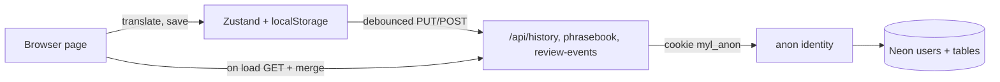

# Anonymous Neon persistence

**Date:** 2026-10-20  
**Status:** Design approved in chat 2026-10-20; awaiting spec review  
**Branch context:** `feature/phase-6-neon-cloud-persistence`  
**Builds on:** `docs/superpowers/specs/2026-07-19-phase-6-public-readiness-design.md` (Neon schema, sync APIs, merge logic)

---

## 1. Intent

**Objective.** On the deployed Render app, history, phrasebook, practice stats, and review events survive a page refresh because they are stored in Neon. No sign-in is required. The newest translation is shown again after a refresh.

**Required behavior**

- A browser is identified by an httpOnly cookie. Neon rows for that browser are loaded on page load and updated after changes.
- After a refresh, the newest history entry is put back into the input and result.
- With `DATABASE_URL` unset, the app behaves as today: browser storage only, no errors shown.

**Constraints**

- Neon only. No Render disk, no Render Postgres. The Render service stays on the free plan with an ephemeral filesystem.
- Reuse the existing Neon tables, `/api/history`, `/api/phrasebook`, `/api/review-events`, `mergeById`, and the Zustand stores.
- Translate, dictionary, and `/api/health` keep working with Neon unset or unreachable.
- Start small. The design must not block later growth (see section 7).

**Non-goals**

- Removing or changing the Google sign-in code. It stays, unused.
- Sharing data across browsers or recovering data after cookies are cleared.
- Account linking, stale-user cleanup, offline queueing, per-row sync, new tables.

**Acceptance criteria**

1. With Neon configured, save a phrase and translate once, reload: History and Phrasebook are present and the last translation is on screen.
2. Clear browser storage but keep the cookie, reload: History and Phrasebook come back from Neon. No Neon rows are deleted.
3. A new browser, or cleared cookies, starts empty and creates a new Neon user.
4. With `DATABASE_URL` unset, translate, history, and phrasebook work from the browser, and no sync error toast appears.
5. `/api/health` and `/api/translate` pass with Neon unset.

---

## 2. Identity

**Cookie.** `myl_anon`, set by the server on the first write.

| Attribute | Value |
|---|---|
| Value | 32 random bytes, base64url |
| Flags | `httpOnly`, `sameSite=lax`, `secure` in production, `path=/` |
| Lifetime | 400 days |

**Storage.** The database stores only the SHA-256 hash of the token in `users.anon_token_hash`. The cookie is never the row id. Existing `users.email` stays nullable and unused for anonymous users.

**Resolution rule for sync routes.**

1. If a NextAuth session has `user.id`, use it (existing Google path, unchanged).
2. Otherwise read `myl_anon`, hash it, look up the user.
3. `GET` with no valid cookie returns an empty list and creates nothing.
4. `PUT` and `POST` with no valid cookie create a user, set the cookie, and continue.

Creating a user on write only keeps drive-by reads from filling `users`. User creation is rate limited by client IP using the existing `checkRateLimitForKey`.

---

## 3. Schema

New migration `db/migrations/003_anon_users.sql`:

```sql
ALTER TABLE users
  ADD COLUMN IF NOT EXISTS anon_token_hash TEXT UNIQUE;
```

No other table changes. History, phrasebook, and review events already key on `user_id` and are scoped per user in `lib/db/*`. The migration is idempotent and runs through the existing `npm run db:migrate` and the Neon migrate workflow.

---

## 4. Server changes

| File | Change |
|---|---|
| `db/migrations/003_anon_users.sql` | New column and unique index |
| `lib/db/users.ts` | Add lookup by token hash and create anonymous user |
| `lib/anon-identity.ts` (new) | Read cookie, hash, resolve or create, set cookie |
| `lib/auth-session.ts` | `requireUserId` becomes session id, else anonymous id; reads return empty when no cookie |
| `/api/history`, `/api/phrasebook`, `/api/review-events` | Use the new resolution; unchanged payloads |

The three routes keep their `501` when `DATABASE_URL` is unset and `503` on database errors. A route-level 401 is no longer returned for a missing session.

---

## 5. Client changes

| File | Change |
|---|---|
| `lib/sync/cloud-sync.ts` | Add `pullAllStores()`; `syncAllStores()` stays for writes. A `501` response is a silent skip, not a toast. |
| New client component mounted in `app/layout.tsx` | On mount, wait for store rehydration, run `pullAllStores()`, then subscribe to the three stores and run `syncAllStores()` debounced (2 s) after changes |
| `app/page.tsx` | After history rehydrates, if no result is shown, restore `items[0]` with the existing `restoreRecord` |

**Pull before push.** On load the client first pulls and merges with `mergeById`, so local data is a superset of server data before any push. Pushes add or update rows, and delete only rows this browser saw on the server and then removed locally: the client names them in an explicit `deletedIds` list and the server never deletes a row that is not named. A failed or empty first load therefore never deletes cloud rows, so the old empty-list guard is no longer needed.

**Restore latest result.** Reads from the local history store, so it also works with Neon unset.

---

## 6. Data flow



---

## 7. Growth path (not built now)

| Later need | How the design allows it |
|---|---|
| More data | Same tables; per-user indexes already exist (`idx_translations_user_id`, `idx_phrasebook_user_id`, `idx_review_events_user_id`). Move to Neon's pooled URL if connections become a limit. |
| Cross-browser access | Add Google sign-in later: on first sign-in, attach the email to the current anonymous user instead of creating a new one. Existing rows keep their `user_id`. |
| Stale anonymous users | Scheduled SQL delete of users with no recent rows. Not needed at current scale. |
| Abuse | Per-IP limit on user creation now; payload caps and per-user limits are already in the route layer (`apps/web/lib/sync/limits.ts`). |

---

## 8. Deploy

1. Create the Neon database (direct URL, `sslmode=require`, AWS US West Oregon).
2. Run migrations 001–004 (004 drops the phrasebook → translations foreign key) with the existing workflow or `npm run db:migrate`.
3. Set `DATABASE_URL` on the Render service. Keep `AUTH_SECRET` and `AUTH_URL` as they are today.
4. Redeploy. No `NEXT_PUBLIC_GOOGLE_AUTH` change and no Google OAuth setup.

---

## 9. Assumptions to confirm during implementation

- `auth()` returns `null` without throwing when no Google provider is configured. The live translate route already depends on this.
- Writing a cookie from a Next.js route handler works in this repo's Next.js version. Read `node_modules/next/dist/docs/` first (see `apps/web/AGENTS.md`).
- Sync routes are not currently rate limited per user. Only user creation is rate limited; payload caps live in `apps/web/lib/sync/limits.ts` (request body 5 MB with `413` when over a limit, at most 2,000 phrasebook rows per user, review events trimmed on the server to the newest 5,000 per user).

## 10. Verification

- Vitest: anonymous resolve and create, hash only in DB, `GET` without cookie creates no user, 501 silent skip, pull-then-merge does not delete, route tests updated for the 401 change.
- Playwright: reload shows the last translation; sync-auth spec still passes.
- Manual on Render after deploy: acceptance criteria 1 to 5.
